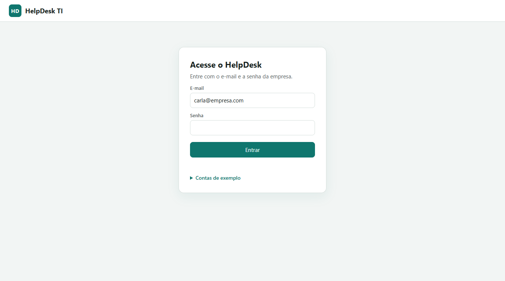
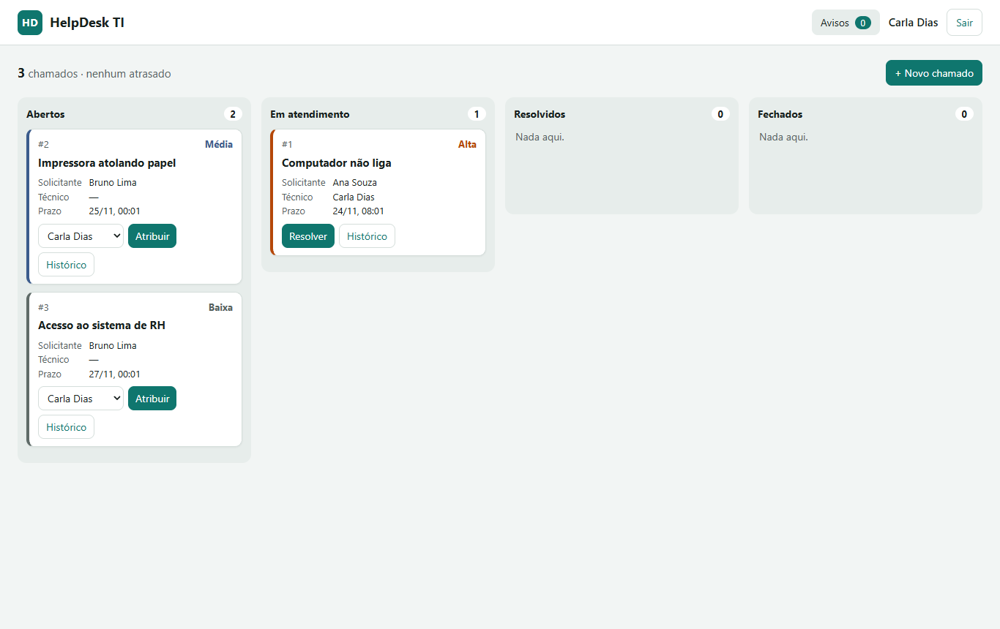
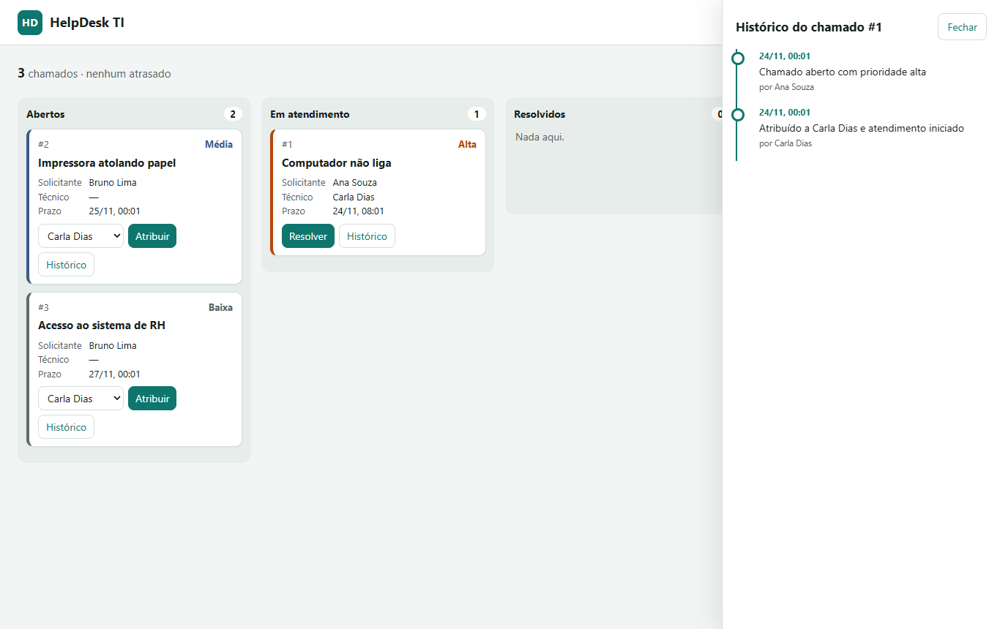
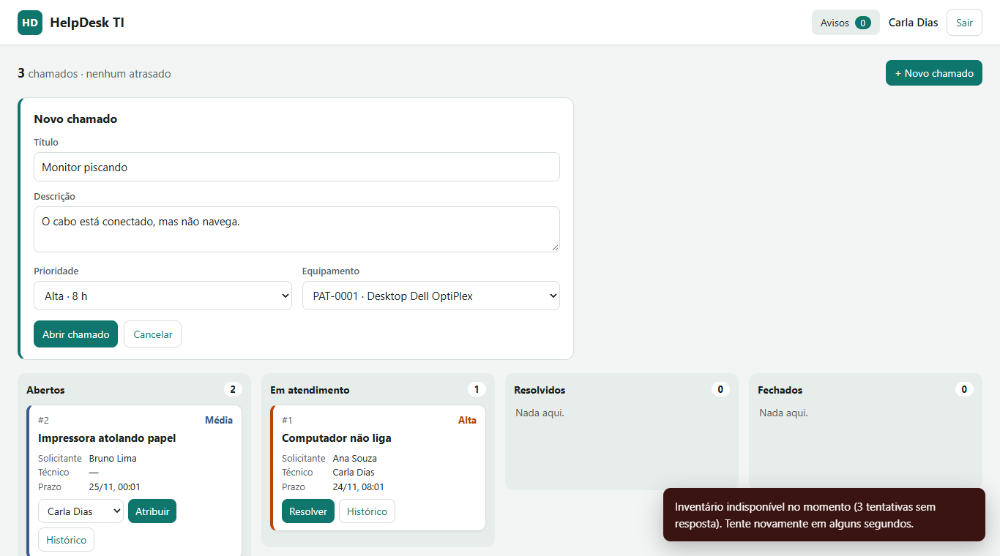
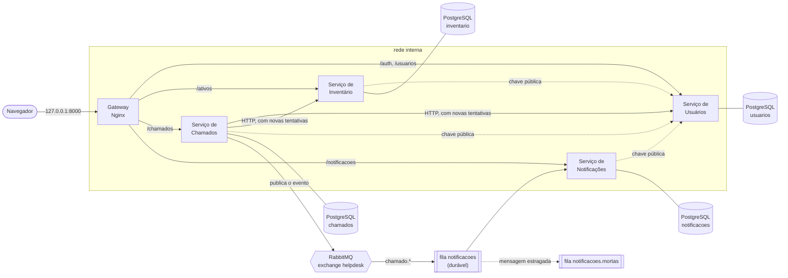

# HelpDesk TI em microsserviços

**🎥 Vídeo de demonstração:** _(cole aqui o link do vídeo)_

O HelpDesk TI era um monólito: uma aplicação, um banco e uma implantação. Esta versão divide o
sistema em quatro serviços independentes, cada um com o seu PostgreSQL, atrás de um gateway Nginx,
com os avisos passando por uma fila do RabbitMQ. O enunciado está em [DESAFIO.md](DESAFIO.md), e o
detalhe de cada parte, em [IMPLEMENTACAO.md](IMPLEMENTACAO.md).

| Entrada | Quadro de chamados | Histórico do chamado | Inventário parado |
|---|---|---|---|
|  |  |  |  |

## Arquitetura



- **Só o gateway tem porta para fora**, e só no próprio computador. Os serviços conversam pela rede
  interna do Docker, pelo nome (`http://inventario:8000`).
- **Cada banco fica numa rede só dele**, junto com o serviço dono. Nenhum outro contêiner alcança aquele
  banco: o serviço de Chamados nem encontra o nome `banco-usuarios`.
- **O token é assinado com a chave privada do serviço de Usuários** (RS256). Os outros serviços
  conferem com a chave pública, que Usuários publica em `/auth/chave-publica`.

Como um pedido é conferido, do login até um chamado aberto:

```mermaid
sequenceDiagram
    participant N as Navegador
    participant G as Gateway (Nginx)
    participant U as Usuários
    participant C as Chamados
    participant I as Inventário
    participant R as RabbitMQ
    N->>G: POST /auth/login
    G->>U: encaminha
    U-->>N: token assinado com a chave privada
    N->>G: POST /chamados (com o token)
    G->>C: encaminha
    C->>U: GET /auth/chave-publica (só na primeira vez; guarda por 5 min)
    Note over C: confere a assinatura do token
    C->>I: GET /ativos/{id} (repassa o token)
    Note over I: confere o token do mesmo jeito
    I-->>C: o equipamento existe
    C->>C: grava o chamado e a 1ª linha do histórico
    C-)R: ChamadoAberto (em segundo plano)
    C-->>N: 201
```

## Como rodar

```bash
docker compose up --build
```

A tela fica em **http://localhost:8000**. Não precisa configurar nada: sem `.env`, tudo sobe com os
valores padrão, e a chave que assina os tokens é gerada na primeira subida.

| E-mail | Senha | Perfil |
|---|---|---|
| `carla@empresa.com` · `diego@empresa.com` | `Helpdesk2026` | técnico: vê tudo, atribui e resolve |
| `ana@empresa.com` · `bruno@empresa.com` | `Helpdesk2026` | solicitante: abre e vê só os próprios chamados |
| `admin@empresa.com` | `Helpdesk2026` | administrador: tudo, inclusive cadastrar usuários |

- `docker compose ps` mostra cada contêiner como **healthy** quando ele e o banco dele estão respondendo.
- `docker compose down -v` apaga os bancos e a fila; a próxima subida começa só com os dados de exemplo.
- Os testes rodam por serviço: dentro da pasta do serviço, `pip install -r requirements.txt pytest httpx`
  e `pytest -q`. No GitHub Actions, cada serviço roda num job próprio.

## Decisões

| Decisão | Por quê | O preço |
|---|---|---|
| **Gateway em Nginx**, só configuração | encaminhar por prefixo de rota é o que o Nginx faz de melhor; não há código de gateway para manter | erros e limites ficam em `nginx.conf`, que tem a sintaxe dele |
| Nginx **consulta o nome do serviço a cada 10 s** (`resolver`) | o gateway sobe mesmo com um serviço parado e volta a encontrá-lo quando ele religa; um serviço fora vira 503 em JSON | uma consulta de nome a mais de tempos em tempos |
| **Limite de requisições no gateway** | 20 por segundo por endereço, e 10 por minuto no login: a força bruta para antes de chegar ao serviço | — |
| **Token RS256: chave privada só em Usuários** | só quem tem a privada cria token; os outros conferem com a pública. Não existe um segredo copiado em quatro lugares | os serviços buscam a chave pública em Usuários (uma vez, com cópia guardada por 5 min) |
| **Chave privada guardada no banco de Usuários** | sobe sem nenhum passo manual e não muda a cada reinício; o `.env` pode trazer uma fixa | apagar o banco de Usuários troca a chave e encerra os logins |
| **PostgreSQL por serviço, cada um na sua rede** | o requisito "nenhum serviço lê o banco de outro" é garantido pela rede, não só pelo código | quatro bancos para subir; sem senha dentro da rede de cada um (em produção, com senha) |
| **Novas tentativas com espera crescente** em Chamados | uma falha passageira (serviço reiniciando) se resolve sozinha na segunda tentativa, sem o usuário ver | com o serviço realmente fora, o erro leva até 3,6 s para chegar |
| **Prazo por tentativa** que conta até a busca do nome | o tempo limite do httpx não cobre a busca do nome na rede, e com o serviço parado ela podia levar 4 s | uma thread por consulta |
| **RabbitMQ com fila durável, mensagens persistentes e fila de mortas** | com Notificações parado, os avisos esperam; uma mensagem estragada vai para a fila de mortas e não trava as outras | mais um contêiner |
| **Eventos publicados em segundo plano** | quem abre o chamado não espera o RabbitMQ; os eventos saem na ordem em que aconteceram | com o RabbitMQ fora, o aviso fica só no log |
| **Histórico de cada chamado** | quem abriu, quem atribuiu, cada mudança de status e cada comentário, com data e autor | uma tabela a mais em Chamados |
| ***Healthchecks*** com o banco junto | `/saude` só responde se o banco responder; cada serviço só sobe depois do banco dele | a primeira subida espera os bancos ficarem prontos |
| **Cada serviço é um projeto inteiro** | cada pasta tem o próprio código, testes, `requirements.txt` e `Dockerfile`, e pode ir para outro repositório sem levar nada junto | a conferência do token está copiada em três serviços |

## O que mudou em relação ao monólito

**Melhorou**
- Uma parte pode cair sem derrubar as outras: com o Inventário parado, os chamados continuam sendo listados,
  atribuídos e resolvidos.
- Cada serviço pode ser publicado, reiniciado e escalado sozinho.
- Os dados de cada parte ficam isolados, inclusive na rede.
- Nenhum aviso se perde porque o serviço de Notificações estava fora.

**Ficou mais difícil**
- O que era uma chamada de função agora passa pela rede: pode demorar, falhar ou voltar pela metade, e o
  código precisa tratar cada caso.
- Sem chave estrangeira entre bancos, a existência do técnico e do equipamento é conferida na hora, pela rede.
- São dez contêineres para subir, acompanhar e manter atualizados.
- Para entender um problema, é preciso olhar o log de vários serviços.

## Estrutura

```
gateway/               Nginx: nginx.conf, a tela (web/) e os testes da tela
servico-usuarios/      cada serviço: app/, tests/, requirements.txt, Dockerfile e pytest.ini
servico-inventario/
servico-chamados/      app/clientes.py (novas tentativas) · app/eventos.py (RabbitMQ)
servico-notificacoes/  app/consumidor.py (fila e fila de mortas)
rabbitmq/              configuração do RabbitMQ
docker-compose.yml     os dez contêineres, as redes e os volumes
```

## Testes

| Parte | Testes | Destaques |
|---|---|---|
| Usuários | 23 | login, bloqueio de tentativas, token de outra chave, sem assinatura, vencido e a troca de algoritmo (HS256 com a chave pública) |
| Inventário | 16 | permissões, entrada inválida e o que acontece quando Usuários não entrega a chave pública |
| Chamados | 31 | o fluxo inteiro com o histórico; falha passageira resolvida, 3 tentativas e 503, prazo por tentativa, fila durável com fila de mortas |
| Notificações | 7 | aviso só do destinatário, confirmação depois de gravar, mensagem estragada para a fila de mortas, reconexão com espera crescente |
| Gateway | 4 | a tela escapa o HTML e não tem script embutido; o Nginx tem os cabeçalhos, os limites e só as rotas conhecidas |
